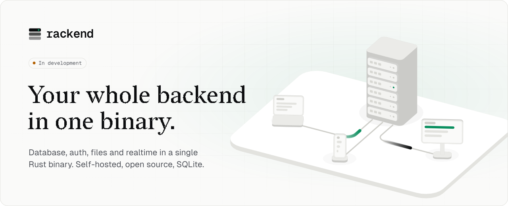

<p align="center">
  <a href="https://rackend.axanet.ch">
    <picture>
      <source media="(prefers-color-scheme: dark)" srcset=".github/assets/hero-dark.svg">
      
    </picture>
  </a>
</p>

<p align="center">
  <a href="https://github.com/axanet/rackend/actions/workflows/ci.yml"></a>
  <a href="https://github.com/axanet/rackend/actions/workflows/conformance.yml"></a>
  <a href="LICENSE"></a>
  <a href="docs/deployment.md"></a>
  <a href="Cargo.toml"></a>
  <a href="Cargo.toml"></a>
</p>

<p align="center">
  <a href="https://rackend.axanet.ch"><b>Website</b></a> ·
  <a href="docs/guide/getting-started.md"><b>Getting started</b></a> ·
  <a href="docs/guide/README.md"><b>Guides</b></a> ·
  <a href="docs/deployment.md"><b>Deployment</b></a> ·
  <a href="docs/adr"><b>Architecture</b></a>
</p>

**rackend** is a self-hosted, single-binary backend-as-a-service written in Rust, inspired by [PocketBase](https://pocketbase.io). One binary (or one container) gives you a database with an admin UI, a REST API with access rules, authentication (including an OpenID Connect provider), file storage, realtime and observability. SQLite is the only database.

> [!NOTE]
> rackend is in early development. Milestones M0 to M9 are done and everything below works today; pin a minor version (`x.y`) so upgrades are deliberate.

## Features

- **Collections and REST API.** Define collections in the admin UI and get a REST API with [access rules](docs/guide/rules.md) that decide who may see and change what.
- **Authentication.** Passwords, passkeys, one-time codes by email, verification, password reset and email change, and sign-in through Google, Microsoft Entra ID, Apple, GitHub or any OpenID Connect issuer.
- **OpenID Connect provider.** [Sign users in to your own apps](docs/guide/sign-in-for-apps.md) with rackend, tested nightly against the OpenID Foundation conformance suite (Basic OP and Config OP).
- **Files.** Uploads on local disk or any S3-compatible bucket (AWS S3, RustFS, Garage, Cloudflare R2), with thumbnails made on demand.
- **Realtime.** [Record events](docs/realtime-protocol.md) over SSE and WebSocket, channels with presence, and collaborative editing with Yjs.
- **Data safety.** Scheduled and on-demand backups with a checksum for every file, a verified snapshot before every upgrade, and secrets encrypted at rest.
- **Observability.** A dashboard in the admin UI, request logs, an audit log, Prometheus metrics and OpenTelemetry export.
- **Typed clients.** An [OpenAPI document](docs/guide/clients.md) for generating clients in your language; TypeScript and Python are tested in CI.
- **Small and portable.** One container image for linux/amd64 and linux/arm64, under 40 MB compressed. No external services required.

## Quick start

```sh
docker run -d --name rackend -v rackend_data:/data -p 8080:8080 ghcr.io/axanet/rackend:0.1
docker logs rackend    # prints a one-time link to create the first superuser
```

The admin UI is at <http://localhost:8080/_/>, the API under `/api/`. The [getting started guide](docs/guide/getting-started.md) takes you from here to a collection with access rules and a generated client in about five minutes; [deployment](docs/deployment.md) covers storage, reverse proxies, email, sign-in providers, monitoring, backups and upgrades.

## Develop

All tools and tasks are managed with [mise](https://mise.jdx.dev):

```sh
mise install          # Rust, bun, cargo-nextest, cargo-deny (pinned)
mise run build        # admin UI + release binary
mise run dev          # run the server (data in ./.data)
mise run test         # all tests
mise run test:upgrade # upgrade-path tests against committed fixtures
mise run test:clients # OpenAPI validation + generated TypeScript/Python clients (Docker, python3)
mise run test:broker  # sign-in against Keycloak (Docker)
mise run test:conformance # OpenID conformance suite, Basic OP + Config OP (Docker)
mise run lint         # fmt, clippy -D warnings, cargo-deny, migration immutability
```

```
crates/core         domain, use cases and ports; no I/O
crates/store-sqlite, http, blob-fs, blob-s3, …   adapters
crates/rackend      the binary and composition root
admin-ui            SvelteKit admin UI, embedded in the binary
```

Architecture decisions are recorded in [docs/adr](docs/adr); error responses are documented in [docs/errors.md](docs/errors.md), the threat model in [docs/threat-model.md](docs/threat-model.md).

## Contributing

Issues are welcome; pull requests from outside the axanet organization are closed automatically. See [CONTRIBUTING.md](CONTRIBUTING.md) and, for vulnerabilities, [SECURITY.md](SECURITY.md).

## License

Apache License 2.0, see [LICENSE](LICENSE) and [NOTICE](NOTICE). Bundled third-party material keeps its own license:

- The admin UI bundles the Redaction 20 font by MCKL and the Geist fonts by Vercel, all under the SIL Open Font License 1.1. Their license texts ship with the UI in [admin-ui/static/licenses](admin-ui/static/licenses) (served at `/_/licenses/`); the font files are used unmodified.
- The list of common passwords comes from SecLists by Daniel Miessler, under the MIT License ([crates/core/data/common-passwords.LICENSE](crates/core/data/common-passwords.LICENSE)).

The container image carries LICENSE and NOTICE in `/licenses/`.

<p align="center">
  <sub>Made by <a href="https://github.com/axanet">axanet</a>.</sub>
</p>
